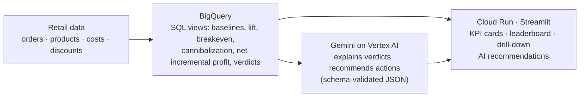

# AI Promotion Intelligence

**Which promotions make money, not just sales?**

AI Promotion Intelligence finds the retail promotions that create incremental profit, the ones that waste margin, and the products that should get the next promotion. BigQuery computes the metrics, Gemini on Vertex AI explains each result and recommends what to change, and a Streamlit app on Cloud Run puts it in front of category managers.

**Live demo:** https://promo-intel-631188837802.us-central1.run.app

> *"This promotion increased sales by 32%, but reduced gross profit by $417. Cut the discount from 30% to 10%."*

## Why sales lift is the wrong metric

A discount raises sales, but it also:

- gives away margin on units that would have sold anyway, and
- can steal sales from sibling products in the same category (cannibalization).

So a promotion can lift revenue by 30% and still lose money. This project ranks every promotion by **net incremental profit** instead:

```
baseline units          = the product's average daily units in the 28 days before the promotion × promotion days
incremental profit      = actual gross profit − baseline units × (list price − unit cost)
cannibalization profit  = profit change of other products in the same category vs. their own baselines
net incremental profit  = incremental profit + cannibalization profit
breakeven lift          = discount / (margin − discount)
```

The breakeven lift is the unit increase needed just to break even. A 30% discount on a 35% margin product needs **+600%** more units; +89% isn't close.

Each promotion gets a deterministic verdict from SQL, evaluated in this order:

| Verdict | Rule |
|---|---|
| **Winner** | net incremental profit > 0 |
| **Cannibalizer** | own incremental profit > 0, but net < 0 after the category effect |
| **Subsidy Dud** | lift < 10%: the discount mostly went to customers who would have bought anyway |
| **Margin Trap** | revenue went up, profit went down |
| **Underperformer** | everything else |

## Architecture



- **Metrics live in SQL** ([sql/](sql/)), so the ranking is auditable and the AI never computes or invents numbers.
- **Gemini only explains.** It receives a promotion's metric row (percentages pre-formatted, plus a computed safe discount) and must answer in a fixed JSON schema, validated with Pydantic.
- **The AI degrades gracefully.** On a timeout, error or invalid JSON, the app falls back to a stored or rule-based insight and labels it "Offline insight".
- **Next promotions** are scored by margin × the category's *net* lift (sales stolen from siblings don't count), with the deepest discount whose breakeven is covered by that lift with a 1.5× safety margin.

## What the prototype finds

The repo generates six months of realistic **synthetic** transactions (76k sales lines, 20 products, 4 categories, 10 promotions) with known business stories built in:

| Promotion | Verdict | What happened | Net incremental profit |
|---|---|---|---|
| Serum Glow 10% Off | Winner | +61% units vs. a 20% breakeven | +$988 |
| Dish Soap 20% Off | Subsidy Dud | ~4% lift: discount given on sales that would have happened anyway | −$388 |
| Cola Summer Blast 30% Off | Margin Trap | +89% units, revenue up 32%, but breakeven needed +600% | −$417 |
| Herbal Shampoo 15% Off | Cannibalizer | +81% units, but the sibling shampoo lost $1,384 of profit | −$663 |

Overall: $627K revenue, yet promotions netted **−$594**, and 4 of 10 lost money.

## Project layout

```
generate_data.py          synthetic retail data with planted promotion stories → data/*.csv
scripts/setup_bigquery.py load data into BigQuery and create the SQL views
scripts/freeze_fixtures.py snapshot live outputs into promo_intel/fixtures/ for offline mode
sql/                      metric views (product daily, promo performance, promo daily, next candidates)
promo_intel/              data access (BigQuery or fixtures), Gemini layer, rule-based fallback, schemas
app.py                    Streamlit UI
tests/                    unit, contract, AI-fallback, story (BigQuery) and UI smoke tests
```

## Run it

Requires [uv](https://docs.astral.sh/uv/) (it installs Python 3.11 for you).

### Offline, no Google Cloud needed

Uses the frozen outputs in `promo_intel/fixtures/`:

```bash
uv sync
USE_FIXTURES=1 uv run streamlit run app.py
```

### Live, with BigQuery and Gemini

You need a Google Cloud project with billing enabled.

```bash
gcloud auth login
gcloud auth application-default login
gcloud config set project YOUR_PROJECT_ID
gcloud services enable bigquery.googleapis.com aiplatform.googleapis.com \
  run.googleapis.com cloudbuild.googleapis.com artifactregistry.googleapis.com

export GCP_PROJECT=YOUR_PROJECT_ID
uv sync
uv run python generate_data.py           # writes data/*.csv
uv run python scripts/setup_bigquery.py  # loads tables, creates views
uv run streamlit run app.py
```

| Env var | Default | Purpose |
|---|---|---|
| `GCP_PROJECT` | (required unless `USE_FIXTURES=1`) | Google Cloud project |
| `GCP_LOCATION` | `us-central1` | Vertex AI location |
| `BQ_DATASET` | `promo_intel` | BigQuery dataset |
| `GEMINI_MODEL` | `gemini-2.5-flash` | Gemini model on Vertex AI |
| `USE_FIXTURES` | `0` | `1` = serve frozen fixtures, no GCP calls |

## Tests

```bash
uv run pytest                    # unit, contract, AI fallback and UI smoke tests (offline)
uv run pytest -m integration     # BigQuery tests: every planted story gets its expected verdict
```

## Deploy to Cloud Run

The runtime service account needs `roles/bigquery.dataViewer`, `roles/bigquery.jobUser` and `roles/aiplatform.user`.

```bash
gcloud run deploy promo-intel --source . --region us-central1 --allow-unauthenticated --memory 1Gi \
  --set-env-vars "GCP_PROJECT=$GCP_PROJECT,GCP_LOCATION=us-central1,BQ_DATASET=promo_intel,GEMINI_MODEL=gemini-2.5-flash"
```

## Limitations and next steps

- The data is synthetic; a real deployment would connect POS or e-commerce data.
- Baselines are a 28-day pre-period average and ignore seasonality. BigQuery ML forecasting is the natural upgrade.
- Promotions cover one product each. Multi-product and store-level promotions are next.

## Built with

BigQuery · Gemini on Vertex AI (`google-genai`) · Cloud Run · Python 3.11 · Streamlit · Plotly · Pydantic · pytest
